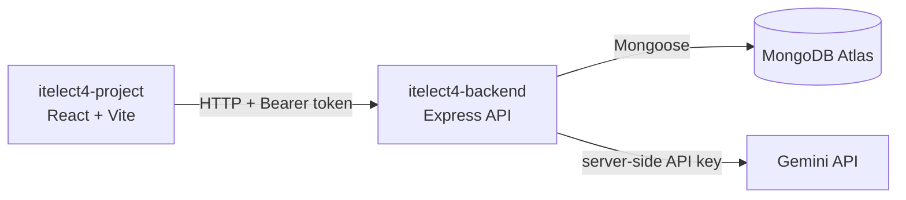

# CIRS Backend

[](https://github.com/bayie27/itelect4-backend/actions/workflows/ci.yml)

This repository contains the backend half of CIRS (Cyber Incident Response Simulator), a fictional educational app for practicing incident-response workflows. Incidents, evidence, users, credentials, and organizations used in the app must remain fictional.

## Live deployments

- **Frontend:** [itelect4-project-roan.vercel.app](https://itelect4-project-roan.vercel.app)
- **Backend health:** [itelect4-backend-roan.vercel.app/api/health](https://itelect4-backend-roan.vercel.app/api/health)

## Architecture



## Repository split

- `itelect4-project` contains the frontend.
- `itelect4-backend` contains the backend.

The repositories are maintained and deployed separately. Session 10 connects their REST boundary while keeping the two deployments separate.

## Shared project references

The documents in [`docs/`](docs/) mirror the frontend repository's canonical CIRS references:

- [Product specification](docs/product-spec.md)
- [Semester roadmap](docs/semester-roadmap.md)
- [Technical reference](docs/technical-reference.md)

The frontend copies remain authoritative. Keep these backend mirrors synchronized when a shared product or architecture decision changes.

## Backend setup

Requirements: Node.js 22 or newer and npm.

```powershell
npm install
Copy-Item .env.example .env
npm run dev
```

## Current API scope

Incident resources use the shared CIRS `Incident` shape. Post-incident report routes return the `IncidentReport` shape. Errors use a JSON object with a `message` and optional `code` or `fieldErrors`.

| Method | Path | Access | Behavior |
| --- | --- | --- | --- |
| GET | `/api/health` | Public | API and MongoDB connection state |
| POST | `/api/auth/register` | Public | Create an account; role defaults to `responder` |
| POST | `/api/auth/login` | Public | Return a two-hour Bearer token and safe user |
| GET | `/api/incidents` | Bearer token | List incidents created by the signed-in user |
| GET | `/api/incidents/:incidentId` | Bearer token | Read a creator-owned incident |
| POST | `/api/incidents` | Incident commander | Create a `DETECTED` incident |
| PATCH | `/api/incidents/:incidentId` | Incident commander | Edit title, summary, description, or severity on a creator-owned incident |
| DELETE | `/api/incidents/:incidentId` | Incident commander | Delete a creator-owned `DETECTED` incident without actions or evidence |
| GET | `/api/incidents/:incidentId/actions` | Bearer token | List response actions for a creator-owned incident |
| POST | `/api/incidents/:incidentId/actions` | Bearer token | Propose an action using title, description, and priority; the server sets proposer and initial status |
| GET | `/api/incidents/:incidentId/evidence` | Bearer token | List creator-owned evidence; responders receive revealed evidence only |
| PATCH | `/api/evidence/:evidenceId/reveal` | Incident commander | Reveal creator-owned evidence and record the revealing commander |
| POST | `/api/ai` | Incident commander | Generate and save a new report version for an owned, resolved incident |
| GET | `/api/incidents/:incidentId/reports` | Authenticated incident owner | List report versions for a creator-owned incident |
| GET | `/api/reports/:reportId` | Authenticated incident owner | Read a report for a creator-owned incident |

All incident, Action, and Evidence reads are scoped to `createdById`. The server controls owner, commander, status, identifiers, and timestamps. ResponseAction status transitions, evidence creation or general edits, and the canonical HTTP-only session target remain outside this graded task.

After registering a fictional incident commander, seed one fictional incident and unrevealed evidence item for that owner with `npm run seed -- --owner <fictional-commander-email>`. The command does not create accounts or passwords and is safe to rerun for the same owner.
